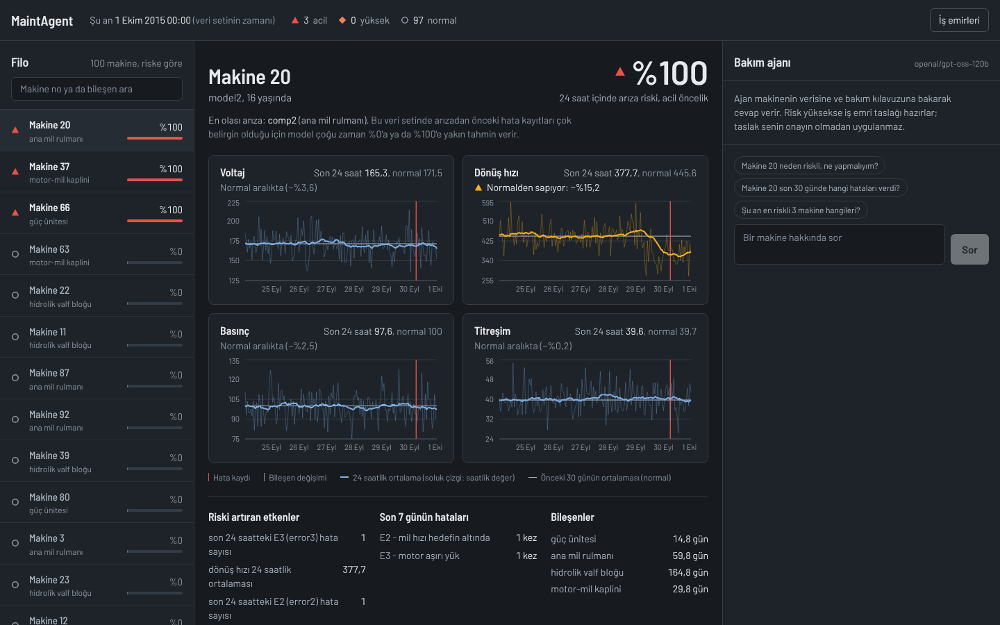
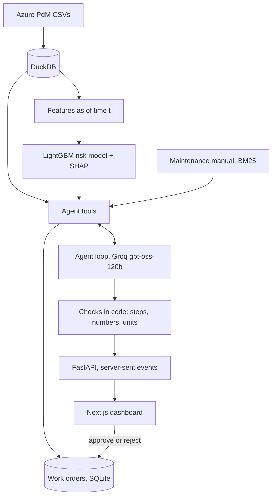

# MaintAgent

A maintenance assistant for a fleet of 100 industrial machines. A gradient-boosted model predicts which component will fail in the next 24 hours. An LLM agent then pulls the evidence with tools, looks up the repair procedure in a maintenance manual, and drafts a work order. The draft does nothing until a person approves it.



Built on the Microsoft Azure Predictive Maintenance dataset (hourly telemetry, error logs, maintenance and failure records for 100 machines in 2015). The UI and the agent speak Turkish; this write-up is in English.

## What it does

1. **Predict.** A LightGBM model scores every machine: probability of a component failure in the next 24 hours, the most likely component, and the three features that pushed the score up (SHAP values).
2. **Investigate.** Ask the agent "Makine 20 neden riskli, ne yapmalıyım?" ("Why is machine 20 at risk, what should I do?"). It reads the machine report, compares sensors with their 30-day normal, checks recent error codes and component ages, and searches the manual.
3. **Act, with a human in the loop.** For high-risk machines the agent drafts a work order (steps, parts, time, manual section). Priority comes from a fixed rule in code, not from the LLM. Only a person can approve or reject the draft.

## Results

### Failure-risk model

Time-based split: trained on January to July 2015, tested on August to December 2015 (120,900 machine-time samples, 1.86% positive).

| Metric (test set) | Model | Rule baseline |
|---|---|---|
| PR-AUC | 0.999 | 0.226 |
| Recall at 80% precision | 1.00 | 0.003 |
| Correct component, on failures | 97.7% | - |

The rule baseline scores each machine by its most-drifted sensor: the largest z-score of a 24-hour sensor mean against that machine's normal.

**Why the score is this high.** A PR-AUC of 0.999 usually means leakage, so I tested for it. Features only use data up to the prediction time, and a test checks that corrupting future telemetry does not change past features. The cause is in the dataset: 1,112 error records sit exactly 24 hours before a failure. The ablation shows where the signal comes from:

| Prediction window | All features | Without error codes | Error codes only | Telemetry only |
|---|---|---|---|---|
| 0-24 h ahead | 0.999 | 0.915 | 0.684 | 0.261 |
| 24-48 h ahead | 0.827 | 0.818 | 0.019 | 0.206 |
| 48-72 h ahead | 0.333 | 0.346 | 0.018 | 0.018 |

Error codes alone are worth 0.684 in the first 24 hours and almost nothing after that, which fits an artifact of how the synthetic data was generated. Without them the model still reaches 0.915; telemetry alone gives 0.261, so the rest comes from adding component ages (days since replacement) and machine attributes. These numbers say more about the dataset than about the method, and I would not expect anything close to them on a real fleet. A side effect: the model's probabilities pile up at 0% and 100%, which the dashboard states next to the score.

### Agent

The agent is tested on 24 moments from the test period. At each one it sees the plant "as of" that hour and nothing after it, and gets a neutral question ("Makine X için durum nedir, ne yapmalıyım?").

- 12 moments 3, 12 or 21 hours before a real failure (3 per component)
- 6 moments with an error code in the last 24 hours but no failure in the next 72 (where false alarms happen)
- 6 quiet moments

Each answer is scored in code: right component, work order drafted or not, every number traceable to a tool output, no invented units, answer format. Script: `scripts/eval_agent.py`, scenarios: `data/eval/agent_scenarios.json`, per-run results: `data/eval/`.

First run (v1, `openai/gpt-oss-120b` on Groq, low reasoning effort):

| Check | v1 |
|---|---|
| Correct component on failures (agent / model alone) | 12/12 / 12/12 |
| Work order drafted before a failure | 12/12 |
| False alarms (error but no failure / quiet) | 0/6 / 0/6 |
| Answers with a number not found in any tool output | about 8/24 |
| Answers with an invented unit (rpm, V, bar, mm/s) | 13/24 |
| Code-level step check had to intervene | 24/24 |
| Tokens per question (median / max) | 9,192 / 10,622 |

The component and false-alarm rows mostly measure the model: on this data the model alone is already right on all 12 failures and gives 0% risk on all 12 negatives. The agent's own contribution shows in the other rows, and those exposed real problems:

- **Invented numbers.** Per-step durations ("≈15 dk") that are not in the manual, sums the model calculated itself, and units the data does not have. My first checker also had two bugs (it flagged "0.6% below" when the tool said -0.6, and it did not catch "V"); the numbers above are re-scored with the fixed checker.
- **Prompt rules were not enough.** In every run the model tried to answer before finishing the required steps, and the check in the loop sent it back.
- **Advice for healthy machines.** The step check required a manual search for every machine, so the agent recommended full inspection procedures for machines at 0% risk.

Changes in v2: the manual search and the draft are required only above the 50% risk threshold; the prompt forbids per-step times, units and arithmetic; and a new check in the loop runs the same number and unit test on the answer before the user sees it, sending it back once with the exact numbers to remove. v2 results are written to `data/eval/agent_summary_v2.md`.

### Manual search

The manual is 33 sections. BM25 over Turkish text, on 20 test questions:

| Method | Correct section in top 3 |
|---|---|
| BM25, whole words | 0.65 |
| BM25, words cut to their first 5 letters | 0.85 |

Turkish adds suffixes to words ("rulmanı", "rulmanda", "rulmanlar"); cutting to 5 letters makes them match. Dense (multilingual-e5-small) and hybrid search are implemented and compared by `scripts/eval_retrieval.py`, but not measured yet, so the app uses BM25. Caveat: the same person wrote the manual and the questions, which favours word matching.

## How it works



**Agent tools:** `get_machine_report` (risk, sensors vs. normal, recent errors, component ages in one call), `get_telemetry_summary`, `get_recent_errors`, `rank_machines_by_risk`, `search_manual`, `draft_work_order`.

## Design decisions

- **No future data, anywhere.** The app runs "as of" a fixed time (`AS_OF`, default 2015-10-01). Every SQL query and feature stops there. Tests insert records after that time and check that no tool sees them.
- **A hand-written agent loop instead of a framework.** One file (`maintagent/agent.py`). Every step is visible, and the loop is tested with a scripted fake LLM, so tests need no API key or network.
- **Rules that matter are enforced in code, not only in the prompt.** The step check and the answer check above exist because the first real runs ignored the prompt.
- **Fewer, larger tools.** Groq's free tier allows 8,000 tokens per minute for this model, and every tool call resends the whole conversation. Merging five evidence tools into one cut the rounds per question from six to four.
- **The LLM proposes, code and people decide.** Work order priority comes from the manual's rule (80% or more is urgent, 50-80% high), the agent has no approve tool, and a second draft for the same machine and component returns the open one.
- **Mistakes go back to the model; bugs do not.** An unknown tool, malformed arguments or an unknown machine return an error message the model can act on. Other exceptions are not sent to the model: the API logs them and shows a generic error, so real bugs are not hidden. Tool names are checked against a list, so the model cannot call internal methods such as the SQL helper.
- **The manual is fictional but tied to the data.** The dataset does not say what comp1-4 are, so names and procedures are invented. The symptoms are not: before each failure type one sensor drifts (comp1 voltage +11%, comp2 rotation -17%, comp3 pressure +23%, comp4 vibration +24%) with its own error code, computed from all 761 failures.
- **Dashboard colour follows control-room practice (ISA-101).** Normal is grey, colour is kept for abnormal states, so the three failing machines stand out among a hundred.

## Limitations

- The dataset is synthetic. The model's numbers do not transfer to a real plant.
- The evaluation sets are small (24 agent scenarios, 20 search questions) and written by the author.
- The number check has blind spots: small integers can match an unrelated value in a tool output by chance.
- Groq's free tier (8,000 tokens per minute, 200,000 per day) allows roughly 20 agent questions a day, and the API runs one agent at a time.
- Probabilities are not calibrated; they cluster at 0% and 100%.

## Run it

```bash
python -m venv .venv
source .venv/bin/activate          # Windows: .venv\Scripts\activate
pip install -r requirements.txt
cp .env.example .env               # then add your GROQ_API_KEY
```

Download the Microsoft Azure Predictive Maintenance dataset from Kaggle and put the five CSV files in `data/raw/`: `PdM_telemetry.csv`, `PdM_errors.csv`, `PdM_maint.csv`, `PdM_failures.csv`, `PdM_machines.csv`.

```bash
python scripts/load_data.py        # CSVs -> data/maintagent.duckdb
python scripts/train_model.py      # train and test the risk model
python scripts/ablation.py         # the ablation table above
python scripts/ask.py "Makine 20 neden riskli, ne yapmalıyım?"
python scripts/eval_agent.py       # agent evaluation (resumes where it stopped)
uvicorn maintagent.api:create_app --factory --reload   # API on :8000, docs at /docs
```

Dashboard (Node.js 20.9+, API running):

```bash
cd frontend
npm install
npm run dev                        # http://localhost:3000
```

Tests: `pytest` runs 72 tests on generated data with the same schema, so no Kaggle download or API key is needed.

## Project layout

```
maintagent/      data loading, features, model, tools, agent loop, checks, API, evaluation
scripts/         command-line entry points (load, train, ablation, ask, evaluations)
data/manual/     maintenance manual and search test questions
data/eval/       agent scenarios and results
frontend/        Next.js dashboard
tests/           pytest suite
```

## Contact

Bora Taykut Hindal
- GitHub: [Taykuth](https://github.com/Taykuth)
- Email: btaykuthindal@gmail.com
